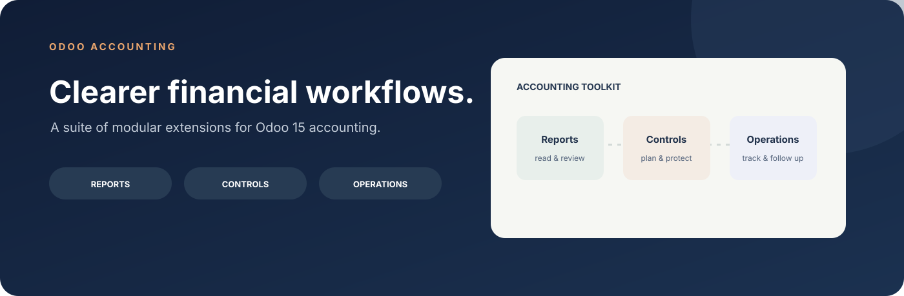

# Odoo Accounting Add-ons

A collection of accounting extensions organized as separate Odoo add-on modules. The manifests identify these modules as Odoo 15 extensions and include author and license details; preserve those notices when using or redistributing the code.

## Modules

| Add-on | What it covers |
| --- | --- |
| [accounting_pdf_reports](accounting_pdf_reports/) | Financial statements and accounting reports |
| [om_account_accountant](om_account_accountant/) | Accounting bundle with companion module dependencies |
| [om_account_asset](om_account_asset/) | Asset tracking and depreciation entries |
| [om_account_bank_statement_import](om_account_bank_statement_import/) | Import bank statements from CSV or XLSX files |
| [om_account_budget](om_account_budget/) | Compare actual results with planned budgets |
| [om_account_daily_reports](om_account_daily_reports/) | Cash book, day book, and bank book reports |
| [om_account_followup](om_account_followup/) | Customer follow-up workflows |
| [om_credit_limit](om_credit_limit/) | Customer credit limits |
| [om_fiscal_year](om_fiscal_year/) | Fiscal year setup and lock dates |
| [om_recurring_payments](om_recurring_payments/) | Scheduled recurring payments |

Each module includes its own <code>__manifest__.py</code>, dependency declarations, views, and supporting code. Check the manifest for dependencies before installing a module.

## Installation notes

This is an add-ons directory, not a standalone Odoo server. Use an Odoo 15 environment, add this repository to the server's <code>addons_path</code>, install required dependencies, then install a specific module from the Odoo Apps interface or command line. Test on a disposable database before using production data.

## Technology

**Odoo 15** · **Python** · **XML views and reports** · **PostgreSQL**

## Attribution

Module manifests name Odoo Mates and Odoo SA as authors for many components and specify LGPL-3 for the add-ons. Refer to each manifest and included license notices for the applicable terms.

---

*Portfolio overview of an existing add-on collection. Verify compatibility and dependencies in your Odoo 15 deployment before installation.*
